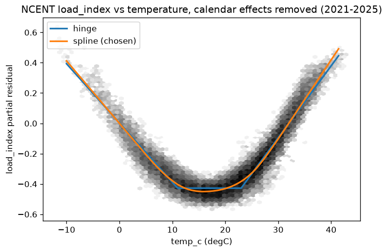
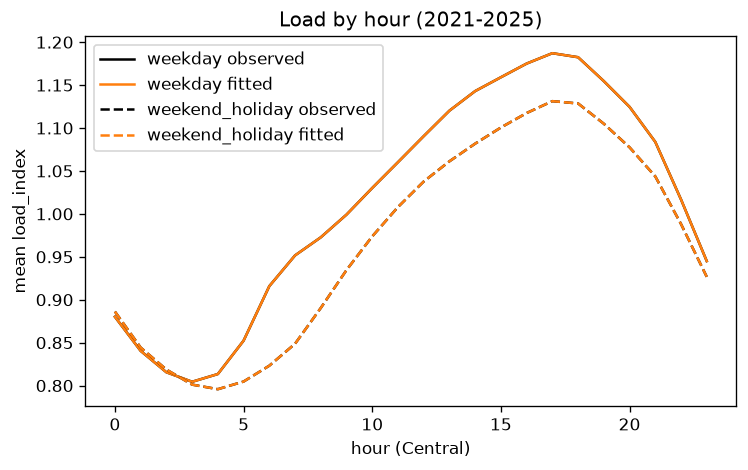
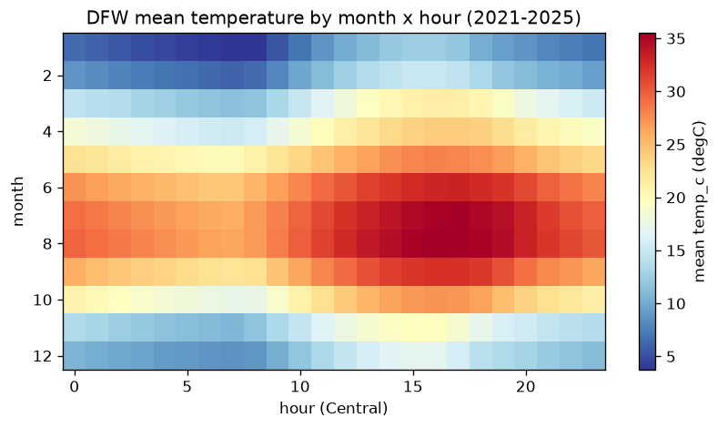
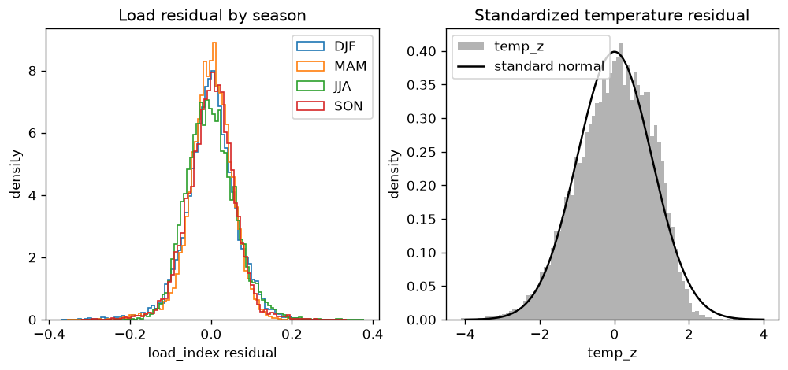
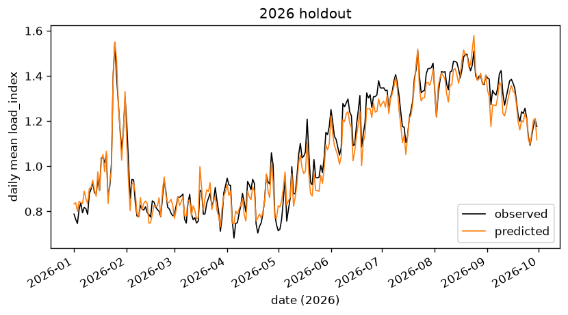

# Driver fit report (Part A)

Produced by `ridethrough/drivers/fit.py` on 2026-10-17. Fit years 2021-2025; holdout 2026.

## Data and cleaning

| step | rows |
|---|---|
| temperature file rows | 50614 |
| temperature flag `missing` dropped | 126 |
| load file rows | 50375 |
| load flag `zones_do_not_sum_to_total` dropped | 48 |
| hours in both files (join on hour_utc) | 50201 |
| Uri load-shed hours dropped (2021-02-14 to 2021-02-20 Central) | 168 |
| final | 50033 (fit 43489, holdout 6544) |

Timing: temp_c is an instantaneous top-of-hour reading; load is the mean over the hour that begins at hour_utc, so each temperature leads its load average by about 30 minutes.

load_index = hourly NCENT load / 365-day rolling mean of daily mean load. Window used by date:

- centered: 2021-06-06 to 2026-05-06
- first_full_window: 2021-01-01 to 2021-06-05
- trailing: 2026-05-07 to 2026-09-30

Mean load_index by year (complete years should be close to 1.0):

| year | mean |
|---|---|
| 2021 | 0.986 |
| 2022 | 1.015 |
| 2023 | 0.995 |
| 2024 | 0.994 |
| 2025 | 1.005 |
| 2026 | 1.083 |

2026 covers January to September only and uses the trailing window, so its mean is not expected to be 1.0.

## Model 1: temperature by month x hour

Mean, sd, n, 5th and 95th percentiles of temp_c and the dewpoint mean and sd for each month x hour: `temp_by_month_hour.csv`. Standardized residual (temp_z) autocorrelation:

| lag | temp_z | load residual |
|---|---|---|
| 1h | 0.977 | 0.882 |
| 24h | 0.611 | 0.499 |
| 168h | 0.042 | 0.258 |

Residuals are strongly autocorrelated hour to hour, so CIs below use a 7-day block bootstrap.

## Model 2: load_index ~ f(temp) + hour x daytype + month

| model | heating balance (degC) | cooling balance (degC) | slope at cold end (per degC) | slope at hot end (per degC) | R2 fit | holdout RMSE |
|---|---|---|---|---|---|---|
| hinge | 11.0 | 23.0 | -0.0391 | 0.0475 | 0.948 | 0.0628 |
| spline (chosen) | 15.9 | 15.9 | -0.0412 | 0.0523 | 0.953 | 0.0605 |

Spline knots: 7, chosen by leave-one-year-out RMSE (5: 0.0611, 6: 0.0606, 7: 0.0605). For the spline, the balance point is the minimum of the curve; slopes are at the 1st and 99th temperature percentiles. The holdout picked between hinge and spline, so the chosen model's holdout RMSE is slightly optimistic.

Residual sd of the chosen model (load_index):

| group | sd |
|---|---|
| overall | 0.0579 |
| DJF | 0.0613 |
| MAM | 0.0527 |
| JJA | 0.0601 |
| SON | 0.0574 |

ERCOT cross-check (spline): balance 14.4 / 14.4 degC, end slopes -0.0281 / 0.0351 per degC, R2 0.927. Correlation of NCENT and ERCOT load_index: 0.972.

## Model 3: Sigma_D for temp_c, load_index, dewpoint_c

95% CIs from a moving-block bootstrap with 7-day blocks, 500 resamples. Full table with covariances: `driver_covariance.csv`.

| group | pair | Pearson [CI] | Spearman [CI] | covariance [CI] |
|---|---|---|---|---|
| overall | temp_c-load_index | 0.487 [0.385, 0.576] | 0.556 [0.455, 0.653] | 1.255 [0.990, 1.508] |
| overall | temp_c-dewpoint_c | 0.803 [0.779, 0.823] | 0.782 [0.747, 0.804] | 71.783 [62.205, 79.491] |
| overall | load_index-dewpoint_c | 0.266 [0.182, 0.334] | 0.360 [0.280, 0.424] | 0.662 [0.455, 0.829] |
| DJF | temp_c-load_index | -0.741 [-0.795, -0.681] | -0.712 [-0.779, -0.636] | -1.099 [-1.386, -0.833] |
| DJF | temp_c-dewpoint_c | 0.716 [0.660, 0.760] | 0.692 [0.633, 0.743] | 43.662 [35.231, 52.369] |
| DJF | load_index-dewpoint_c | -0.638 [-0.695, -0.573] | -0.609 [-0.669, -0.548] | -1.029 [-1.346, -0.774] |
| MAM | temp_c-load_index | 0.601 [0.460, 0.706] | 0.627 [0.509, 0.724] | 0.630 [0.464, 0.783] |
| MAM | temp_c-dewpoint_c | 0.625 [0.561, 0.681] | 0.642 [0.585, 0.693] | 30.185 [24.300, 36.037] |
| MAM | load_index-dewpoint_c | 0.332 [0.242, 0.402] | 0.361 [0.259, 0.442] | 0.426 [0.286, 0.539] |
| JJA | temp_c-load_index | 0.929 [0.922, 0.935] | 0.927 [0.919, 0.934] | 1.126 [1.037, 1.217] |
| JJA | temp_c-dewpoint_c | -0.289 [-0.397, -0.178] | -0.291 [-0.393, -0.178] | -3.105 [-4.173, -1.772] |
| JJA | load_index-dewpoint_c | -0.222 [-0.311, -0.135] | -0.216 [-0.297, -0.133] | -0.149 [-0.202, -0.089] |
| SON | temp_c-load_index | 0.715 [0.639, 0.789] | 0.755 [0.651, 0.835] | 1.208 [1.007, 1.394] |
| SON | temp_c-dewpoint_c | 0.688 [0.627, 0.737] | 0.642 [0.560, 0.702] | 37.137 [28.889, 45.748] |
| SON | load_index-dewpoint_c | 0.372 [0.310, 0.428] | 0.408 [0.330, 0.475] | 0.603 [0.471, 0.735] |

Gaussian copula correlation of the residuals (temp_z, dew_z, load_resid) by season, and by season x 6-hour daypart (Central). The sampler uses the daypart cells: with one copula per season, the sampled JJA temp-load Spearman fell below the data's CI, because the temperature-load residual link differs by time of day.

| season or cell | temp_z-dew_z [CI] | temp_z-load_resid [CI] | dew_z-load_resid [CI] |
|---|---|---|---|
| DJF | 0.782 [0.734, 0.818] | -0.151 [-0.236, -0.072] | -0.087 [-0.154, -0.028] |
| MAM | 0.607 [0.542, 0.657] | 0.213 [0.115, 0.296] | 0.400 [0.320, 0.468] |
| JJA | -0.158 [-0.285, -0.015] | -0.278 [-0.395, -0.162] | 0.420 [0.357, 0.477] |
| SON | 0.636 [0.552, 0.702] | 0.310 [0.200, 0.391] | 0.499 [0.432, 0.563] |
| DJF|00-05 | 0.884 [0.851, 0.908] | 0.041 [-0.083, 0.158] | -0.027 [-0.153, 0.078] |
| DJF|06-11 | 0.869 [0.832, 0.893] | 0.007 [-0.101, 0.112] | -0.017 [-0.108, 0.052] |
| DJF|12-17 | 0.607 [0.523, 0.671] | -0.508 [-0.599, -0.399] | -0.180 [-0.263, -0.081] |
| DJF|18-23 | 0.756 [0.697, 0.800] | -0.147 [-0.240, -0.070] | -0.128 [-0.206, -0.058] |
| MAM|00-05 | 0.758 [0.698, 0.803] | 0.618 [0.542, 0.683] | 0.533 [0.450, 0.606] |
| MAM|06-11 | 0.777 [0.730, 0.811] | 0.342 [0.229, 0.453] | 0.389 [0.266, 0.491] |
| MAM|12-17 | 0.398 [0.324, 0.469] | -0.204 [-0.316, -0.076] | 0.340 [0.242, 0.430] |
| MAM|18-23 | 0.480 [0.395, 0.555] | 0.189 [0.083, 0.287] | 0.392 [0.321, 0.453] |
| JJA|00-05 | -0.027 [-0.182, 0.139] | -0.273 [-0.423, -0.111] | 0.467 [0.378, 0.546] |
| JJA|06-11 | 0.049 [-0.086, 0.194] | -0.178 [-0.312, -0.040] | 0.466 [0.391, 0.533] |
| JJA|12-17 | -0.309 [-0.421, -0.176] | -0.299 [-0.433, -0.167] | 0.409 [0.329, 0.483] |
| JJA|18-23 | -0.335 [-0.455, -0.189] | -0.414 [-0.542, -0.295] | 0.466 [0.384, 0.540] |
| SON|00-05 | 0.759 [0.688, 0.811] | 0.579 [0.473, 0.665] | 0.631 [0.560, 0.689] |
| SON|06-11 | 0.783 [0.729, 0.822] | 0.440 [0.321, 0.544] | 0.533 [0.437, 0.616] |
| SON|12-17 | 0.439 [0.336, 0.521] | 0.012 [-0.106, 0.107] | 0.401 [0.312, 0.478] |
| SON|18-23 | 0.567 [0.451, 0.657] | 0.263 [0.133, 0.368] | 0.457 [0.381, 0.528] |

## Holdout 2026

| group | hours | load_index RMSE | bias (observed - predicted) | temp 5-95% band coverage |
|---|---|---|---|---|
| overall | 6544 | 0.0605 | 0.0156 | 0.862 |
| DJF | 1416 | 0.0592 | -0.0088 | 0.862 |
| MAM | 2200 | 0.0625 | 0.0091 | 0.819 |
| JJA | 2208 | 0.0599 | 0.0308 | 0.966 |
| SON | 720 | 0.0588 | 0.0370 | 0.671 |

Band coverage target is 0.90. SON in 2026 contains September only.

## Figures

## Caveats

- Temperature leads the load average by about 30 minutes (join as specified).
- The holdout was used to choose between hinge and spline.
- 2026 load_index uses the trailing window from 2026-05-07 and is a partial year.
- Bootstrap blocks may span the dropped Uri week.
- Grid load (NCENT) is far more temperature-sensitive than a data center's load; Part B scales the temperature-load link by `coupling` (0, 0.5, 1.0).
